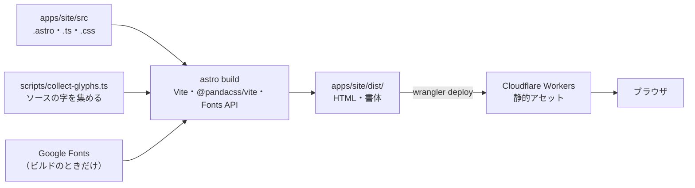

# 全体の構成

今の構成。テンプレート全体の目的は [product.md](../product.md)、機能ごとに何を満たすべきかは [prds/](../prds/README.md)、ファイルの置き場所は [directory-structure.md](directory-structure.md)、スタイルの書き方は [styling.md](styling.md)、この構成にした理由は [design doc](../design-docs/20261031_web-site-template.md) にある。

**今使っている技術と構成の正本はこの文書。** design doc に書いた当時の構成と今が違うときは、こちらが今の構成。構成を変えたら、同じ変更の中でこの文書を直す。

## システムの形

ログインも DB も無い Web サイトを、Astro の静的出力で HTML にし、Cloudflare Workers の静的アセットとして配る。**Worker のスクリプト（リクエストごとに動く処理）は無い。**

## リポジトリ

pnpm workspace と Turborepo のモノレポ。

| パス | 中身 |
| --- | --- |
| `apps/site/` | Web サイト（Astro）。今ある唯一のアプリ |
| `docs/` | ドキュメント（[docs/README.md](../README.md)） |
| ルート | workspace・タスク・lint・整形・Git フック・Renovate の設定 |

`packages/` は無い。管理画面のような 2 つ目の入口を別アプリとして作ると決めたら、`apps/` に足す（[directory-structure.md の「入口が増えたとき」](directory-structure.md#入口が増えたとき)）。

## apps/site

| 役割 | 使っているもの | 設定 |
| --- | --- | --- |
| ページを作る | Astro。静的出力で、adapter は入れていない | `apps/site/astro.config.ts` |
| スタイル | Panda CSS。`@pandacss/vite` が生成物（`styled-system/`）を作り、CSS を注入する | `apps/site/panda.config.ts` |
| 書体 | Astro の Fonts API。ビルドのときに Google Fonts から取り、`dist/` から配る。切り出す字は `scripts/collect-glyphs.ts` が `src/` から集める（[書体](#書体)） | `astro.config.ts` の `fonts` |
| 配信 | Cloudflare Workers の静的アセット。`dist/` をそのまま配る | `apps/site/wrangler.jsonc` |
| 型 | TypeScript（`astro/tsconfigs/strictest`）。`@/*` が `src/*`、`styled-system/*` が Panda の生成物を指す | `apps/site/tsconfig.json` |

ブラウザに届くのは、HTML（CSS と `<script>` を含む）と書体のファイル。

## 機能を支える仕組み

[prds/](../prds/README.md) の要件を、今どう実現しているか。何を満たすべきかは各 PRD にあり、ここには書かない。

すべてのページの `<html>`・`<head>` は `src/components/layout/base-layout.astro`（`BaseLayout`）が持つ。各ページは `src/pages/` で `BaseLayout` に props を渡し、画面を包む。下の仕組みの多くは、このファイルに集まっている。

### ページのメタ情報

[prds/page-metadata.md](../prds/page-metadata.md) の実現。

- タイトル・説明・サイト名・OGP 画像・検索結果に載せない指定は、各ページが `BaseLayout` の props（`title`・`description`・`siteName`・`ogImage`・`noindex`）で渡す
- 公開する URL は `astro.config.ts` の `site` に書く。テンプレートでは注釈にしてあり、入れていない。OGP の絶対 URL は、ページの中で `Astro.site` から作る。`site` が無いうちは、`og:url`・`og:image` 系・`twitter:card` を出さない
- OGP 画像は `public/` に置き、そのパス・幅・高さ・代替テキストを `ogImage` に渡す（[directory-structure.md の「静的ファイルの置き場所」](directory-structure.md#静的ファイルの置き場所)）
- favicon を置くまでは、`<link rel="icon" href="data:," />` でブラウザに `/favicon.ico` を取りに行かせない
- ページの言語は `<html lang="ja">` と `og:locale` で出す

### 書体

[prds/web-font.md](../prds/web-font.md) の実現。

- `astro.config.ts` の `fonts` で、Google Fonts（`fontProviders.google()`）の Noto Sans JP を、太さ `500 800` の 1 ファイルとして取る。代わりの書体は同じ設定の `fallbacks` に書く
- 切り出す字は `scripts/collect-glyphs.ts` が集め、`options.experimental.glyphs` に渡す。`src/` の `.astro` と `.ts` を読み、注釈（`<!-- -->`・`/* */`・`//`）を除いた字と、ASCII の印字できる字を集める。`astro.config.ts` を読み込むときに 1 回だけ動くので、開発サーバーは立ち上げたときの字で切り出す
- `base-layout.astro` の `` が `<head>` で読み込む。`panda.config.ts` の `fonts.ja` トークンは `var(--font-ja)` を指す

### 動き

[prds/motion.md](../prds/motion.md) の実現と書き方は、[styling.md の「動き」](styling.md#動き)にある。

### アクセス解析

[prds/web-analytics.md](../prds/web-analytics.md) の実現。

- Cloudflare Web Analytics のビーコン（`https://static.cloudflareinsights.com/beacon.min.js`）を、`base-layout.astro` の `<body>` の末尾に `defer` で書く。サイトのトークンは同じファイルの定数 `webAnalyticsToken` に書き、`data-cf-beacon` で渡す。定数が空なら、ビーコンを出さない
- Cloudflare の自動の設定には任せず、サイトの側でビーコンを書く。理由は [design doc の「アクセス解析と検索」](../design-docs/20261031_web-site-template.md#アクセス解析と検索)にある
- トークンを環境変数にしない理由は、[構成上の制約](#構成上の制約)にある

### 画面幅

- スマホと PC の切り替えは、`panda.config.ts` の `theme.breakpoints`（`pc: '900px'`）の 1 つだけ。書き方は [styling.md](styling.md)

### 存在しない URL

- `wrangler.jsonc` の `assets.not_found_handling` は `"404-page"`（`404.html` を返す設定）。ただし `src/pages/404.astro` は無く、ビルドの出力にも `404.html` は無い。何を返すべきかは [prds/site.md の「未確認事項」](../prds/site.md#未確認事項)にある

## 開発の道具

| 役割 | 道具 | 設定 |
| --- | --- | --- |
| Node | 版は `.node-version` で固定 | `.node-version` |
| パッケージ管理 | pnpm。版は `package.json` の `packageManager` で固定し、依存は版を固定して入れる（`saveExact`） | `pnpm-workspace.yaml` |
| タスク | Turborepo。`gen`・`dev`・`lint`・`fmt`。`lint` の前に `gen` を流す | `turbo.json` |
| 型の検査 | `astro check` | — |
| lint | oxlint。`correctness` と、層ごとの `no-restricted-imports`（[依存の向き](directory-structure.md#依存の方向)） | `.oxlintrc.json` |
| 使っていないコード | knip | `knip.jsonc` |
| 依存の版のずれ | syncpack | `.syncpackrc` |
| 整形 | `.astro` 以外は oxfmt、`.astro` は Prettier（`prettier-plugin-astro`）。oxfmt は `.astro` を整形しない | `.oxfmtrc.json`・`.prettierrc.json` |
| Git フック | lefthook。pre-commit で lint と整形、pre-push で `pnpm lint` | `lefthook.yml` |
| 依存の更新 | Renovate | `renovate.json5` |
| エディタ | VS Code の推奨拡張（oxc・Astro・Panda CSS） | `.vscode/` |

コマンドの使い方は [runbooks/development.md](../runbooks/development.md) にある。

## 構成上の制約

最初の 2 つは、テンプレートから引き継いだ既定の方針。**ユーザーが明示的に求めれば見直してよい。** 見直すときは、今の構成を保つ案と変える案を比べ、design doc に書いて決める。それ以外は、道具や運用の都合による今の制約。

- **静的出力を基本にする。** 今は、リクエストごとのサーバーの処理を持たない。フォームの送信・ログイン・DB のようにサーバーの処理が要るようになったら、今の構成を保つ案（外部のサービスに任せる、`apps/` に別アプリを足す）と、構成を変える案（Astro の Cloudflare adapter を入れ、サイトにサーバーの処理を持たせる）を比べる
- **UI フレームワークのランタイムを送らず、JS は必要な機能に限る。** React などの UI フレームワークは入れていない。JS は `<script>` を書いたところにだけ出る。今ブラウザで動く JS は、動き（出すかの判定と、画面に入った要素を出す処理）と、トークンを入れたときのアクセス解析のビーコンだけ（要件は [prds/site.md](../prds/site.md#ブラウザで動く-js)）
- **TypeScript は 6 系に据え置く。** `.astro` の型を検査する `astro check` が TypeScript 7 で動かないため（[withastro/astro#17268](https://github.com/withastro/astro/issues/17268)）
- **`styled-system/` はコミットしない。** `pnpm install`（`apps/site` の `prepare`）と `pnpm lint`（turbo の `gen`）の前に作り直す
- **依存は、公開から 7 日経った版だけを入れる。** pnpm（`minimumReleaseAge`）と Renovate の両方で設定していて、2 つの長さは揃える（[runbooks/minimum-release-age.md](../runbooks/minimum-release-age.md)）
- **環境変数と secret は無い。** Web Analytics のトークンは公開の値なので、コードに直接書く
- **CI は無い。** 検査は手元の Git フック（pre-push の `pnpm lint`）で行う。デプロイも手元から行う（[runbooks/deploy.md](../runbooks/deploy.md)）。Cloudflare の Git 連携を使うと、PR ごとのプレビューが出る
- **テストは無い。** テストランナーは入っていない。入れるときの置き場所だけ決めてある（[directory-structure.md の「テストの置き場所」](directory-structure.md#テストの置き場所)）
