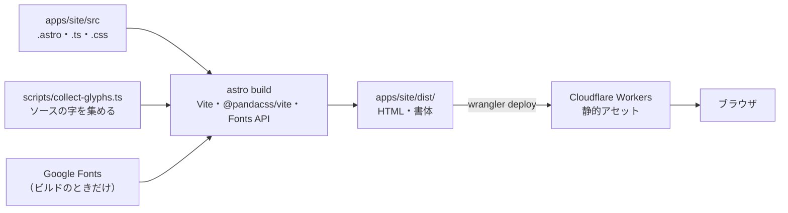

# 全体の構成

今の構成。サイトが何を満たすべきかは [specs/](../specs/README.md)、ファイルの置き場所は [directory-structure.md](directory-structure.md)、スタイルの書き方は [styling.md](styling.md)、この構成にした理由は [design doc](../design-docs/20261031_web-site-template.md) にある。

## システムの形

ログインも DB も無い Web サイトを、Astro の静的出力で HTML にし、Cloudflare Workers の静的アセットとして配る。**Worker のスクリプト（リクエストごとに動く処理）は無い。**

## リポジトリ

pnpm workspace と Turborepo のモノレポ。

| パス | 中身 |
| --- | --- |
| `apps/site/` | Web サイト（Astro）。今ある唯一のアプリ |
| `docs/` | ドキュメント（[docs/README.md](../README.md)） |
| ルート | workspace・タスク・lint・整形・Git フック・Renovate の設定 |

`packages/` は無い。管理画面のような 2 つ目の入口を別アプリとして作ると決めたら、`apps/` に足す（[directory-structure.md の「入口が増えたとき」](directory-structure.md#入口が増えたとき)）。

## apps/site

| 役割 | 使っているもの | 設定 |
| --- | --- | --- |
| ページを作る | Astro。静的出力で、adapter は入れていない | `apps/site/astro.config.ts` |
| スタイル | Panda CSS。`@pandacss/vite` が生成物（`styled-system/`）を作り、CSS を注入する | `apps/site/panda.config.ts` |
| 書体 | Astro の Fonts API。ビルドのときに Google Fonts から取り、`dist/` から配る。切り出す字は `scripts/collect-glyphs.ts` が `src/` から集める | `astro.config.ts` の `fonts` |
| 配信 | Cloudflare Workers の静的アセット。`dist/` をそのまま配る | `apps/site/wrangler.jsonc` |
| 型 | TypeScript（`astro/tsconfigs/strictest`）。`@/*` が `src/*`、`styled-system/*` が Panda の生成物を指す | `apps/site/tsconfig.json` |

ブラウザに届くのは、HTML（CSS と `<script>` を含む）と書体のファイル。

## 開発の道具

| 役割 | 道具 | 設定 |
| --- | --- | --- |
| Node | 版は `.node-version` で固定 | `.node-version` |
| パッケージ管理 | pnpm。版は `package.json` の `packageManager` で固定し、依存は版を固定して入れる（`saveExact`） | `pnpm-workspace.yaml` |
| タスク | Turborepo。`gen`・`dev`・`lint`・`fmt`。`lint` の前に `gen` を流す | `turbo.json` |
| 型の検査 | `astro check` | — |
| lint | oxlint。`correctness` と、層ごとの `no-restricted-imports`（[依存の向き](directory-structure.md#依存の方向)） | `.oxlintrc.json` |
| 使っていないコード | knip | `knip.jsonc` |
| 依存の版のずれ | syncpack | `.syncpackrc` |
| 整形 | `.astro` 以外は oxfmt、`.astro` は Prettier（`prettier-plugin-astro`）。oxfmt は `.astro` を整形しない | `.oxfmtrc.json`・`.prettierrc.json` |
| Git フック | lefthook。pre-commit で lint と整形、pre-push で `pnpm lint` | `lefthook.yml` |
| 依存の更新 | Renovate | `renovate.json5` |
| エディタ | VS Code の推奨拡張（oxc・Astro・Panda CSS） | `.vscode/` |

コマンドの使い方は [runbooks/development.md](../runbooks/development.md) にある。

## 構成上の制約

最初の 2 つは、テンプレートから引き継いだ既定の方針。**ユーザーが明示的に求めれば見直してよい。** 見直すときは、今の構成を保つ案と変える案を比べ、design doc に書いて決める。それ以外は、道具や運用の都合による今の制約。

- **静的出力を基本にする。** 今は、リクエストごとのサーバーの処理を持たない。フォームの送信・ログイン・DB のようにサーバーの処理が要るようになったら、今の構成を保つ案（外部のサービスに任せる、`apps/` に別アプリを足す）と、構成を変える案（Astro の Cloudflare adapter を入れ、サイトにサーバーの処理を持たせる）を比べる
- **UI フレームワークのランタイムを送らず、JS は必要な機能に限る。** React などの UI フレームワークは入れていない。JS は `<script>` を書いたところにだけ出る。今ブラウザで動く JS は、動き（出すかの判定と、画面に入った要素を出す処理）と、トークンを入れたときのアクセス解析のビーコンだけ（[specs/site.md](../specs/site.md#ブラウザで動く-js)）
- **TypeScript は 6 系に据え置く。** `.astro` の型を検査する `astro check` が TypeScript 7 で動かないため（[withastro/astro#17268](https://github.com/withastro/astro/issues/17268)）
- **`styled-system/` はコミットしない。** `pnpm install`（`apps/site` の `prepare`）と `pnpm lint`（turbo の `gen`）の前に作り直す
- **依存は、公開から 7 日経った版だけを入れる。** pnpm（`minimumReleaseAge`）と Renovate の両方で設定していて、2 つの長さは揃える（[runbooks/minimum-release-age.md](../runbooks/minimum-release-age.md)）
- **環境変数と secret は無い。** Web Analytics のトークンは公開の値なので、コードに直接書く
- **CI は無い。** 検査は手元の Git フック（pre-push の `pnpm lint`）で行う。デプロイも手元から行う（[runbooks/deploy.md](../runbooks/deploy.md)）。Cloudflare の Git 連携を使うと、PR ごとのプレビューが出る
- **テストは無い。** テストランナーは入っていない。入れるときの置き場所だけ決めてある（[directory-structure.md の「テストの置き場所」](directory-structure.md#テストの置き場所)）
